<p align="center">
  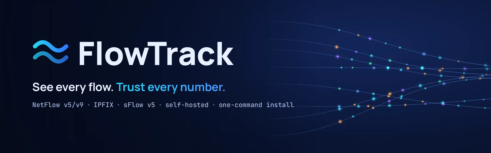
</p>

<p align="center">
  <a href="https://github.com/telesphera/flowsphera/tags"></a>
  
  
  <a href="LICENSE"></a>
</p>

<p align="center">
  <b>English</b> · <a href="README.uk.md">Українська</a>
  <br><br>
  <a href="#install-in-one-command"><b>Install</b></a> ·
  <a href="#a-tour">Tour</a> ·
  <a href="#works-with-your-equipment">Supported devices</a> ·
  <a href="#editions">Editions</a> ·
  <a href="#documentation">Docs</a> ·
  <a href="mailto:flowsphera@telesphera.net?subject=FlowSphera">Contact</a>
</p>

**FlowSphera** turns the NetFlow, IPFIX and sFlow your firewalls, routers and switches already send into a clear, live
picture of your network: who talks to whom, how much, over which service, from where and along which path. It runs on
your own server, installs with one command and is ready in minutes.

> FlowSphera was called **FlowTrack** until version 1.17. Since 2.0 every name on the server is FlowSphera too: the
> `flowsphera` command, the services, the folders. An existing installation upgrades as before — `sudo flowtrack
> upgrade` moves it to the new names by itself and keeps the old command as a synonym until 3.0.

<p align="center">
  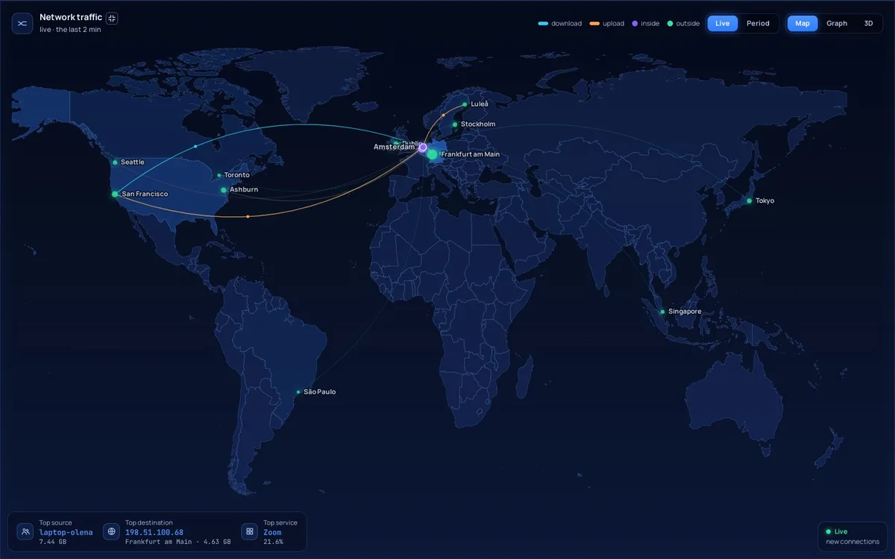
</p>

## Why FlowSphera

<table>
<tr>
<td width="33%" valign="top"><b>Ready in minutes</b><br>One command installs everything — database, web interface, HTTPS — and hands you a ready-made configuration for your firewall or router.</td>
<td width="33%" valign="top"><b>Numbers you can trust</b><br>Correct accounting of long sessions, sampling and duplicate exports; every lost packet is counted and shown, never silently dropped.</td>
<td width="33%" valign="top"><b>See the path, not just the flows</b><br>How traffic crosses your devices, interface by interface — and which link really has a problem.</td>
</tr>
<tr>
<td valign="top"><b>Security built in</b><br>Port scans, password guessing, floods, contact with known malicious addresses, links running full — with alerts to Telegram, e-mail, webhooks and your SIEM.</td>
<td valign="top"><b>Made for the wall</b><br>Live maps, a 3D globe and animated traffic views that run full screen on a NOC display — smooth, light on the CPU.</td>
<td valign="top"><b>Yours</b><br>Self-hosted, no cloud, no telemetry. Every feature is free; a license only raises the limits.</td>
</tr>
<tr>
<td valign="top"><b>Reports that arrive</b><br>A PDF for the management or the duty engineer — daily, weekly or monthly by e-mail, or for exactly the incident on your screen.</td>
<td valign="top"><b>Fits your company</b><br>Sign in with Active Directory or LDAP; roles from your groups; local accounts stay as a way in.</td>
<td valign="top"><b>Connects to your tools</b><br>API tokens for scripts and monitoring, webhooks for chats and your own systems, syslog (CEF / JSON) for the SIEM.</td>
</tr>
</table>

## A tour

### Path analysis — watch traffic move through your network

Every device that exports flows, its neighbours, and the traffic on each link as both ends recorded it — in motion,
in the direction it really goes. A real gap is shown only when traffic goes in and nothing comes back; everything else
is explained in plain words. Trace any source → destination path hop by hop, with NAT.

<p align="center">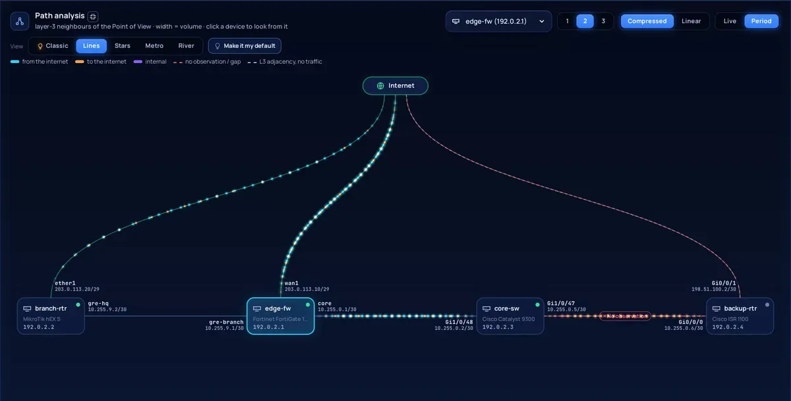</p>

Pick the look that suits you — every user keeps their own default view:

<table>
<tr>
<td width="33%" align="center">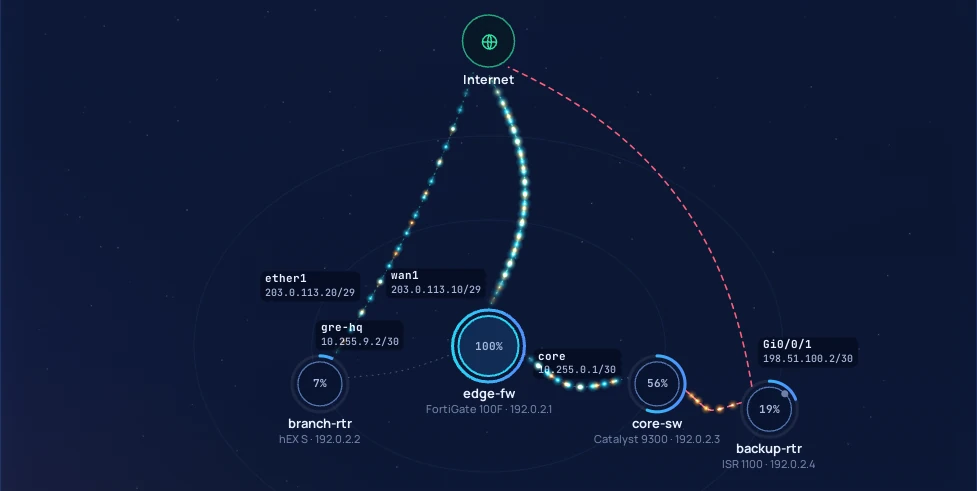<br><b>Stars</b></td>
<td width="33%" align="center">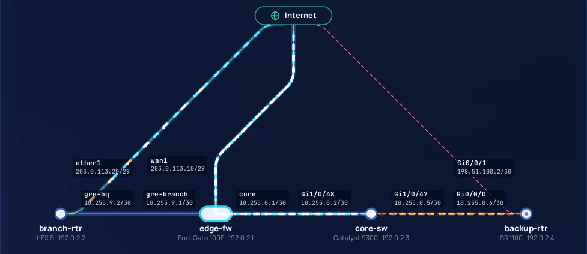<br><b>Metro</b></td>
<td width="33%" align="center">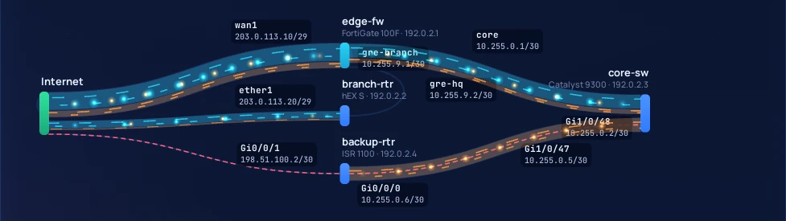<br><b>River</b></td>
</tr>
</table>

### Overview — the whole network at a glance

Totals with trends, the live connection map or a 3D globe, top services, hosts and conversations. Every panel opens
full screen.

<p align="center">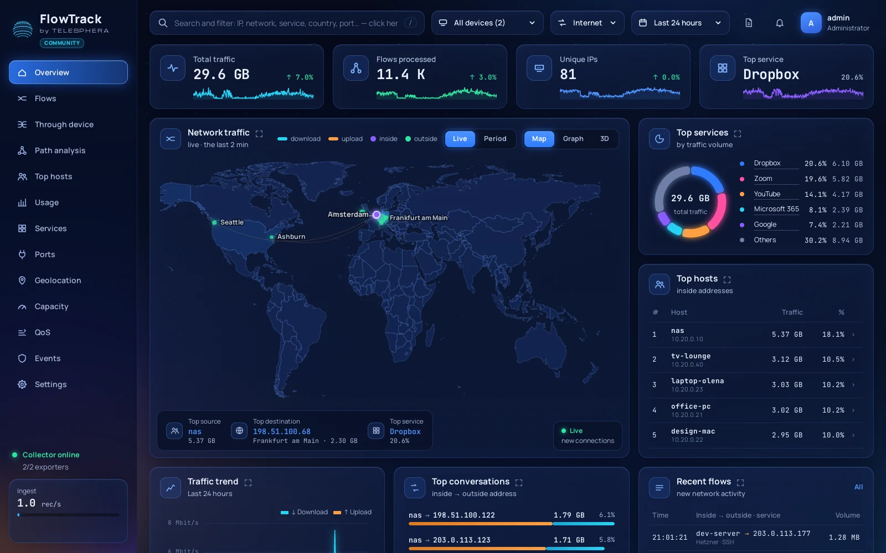</p>

<p align="center">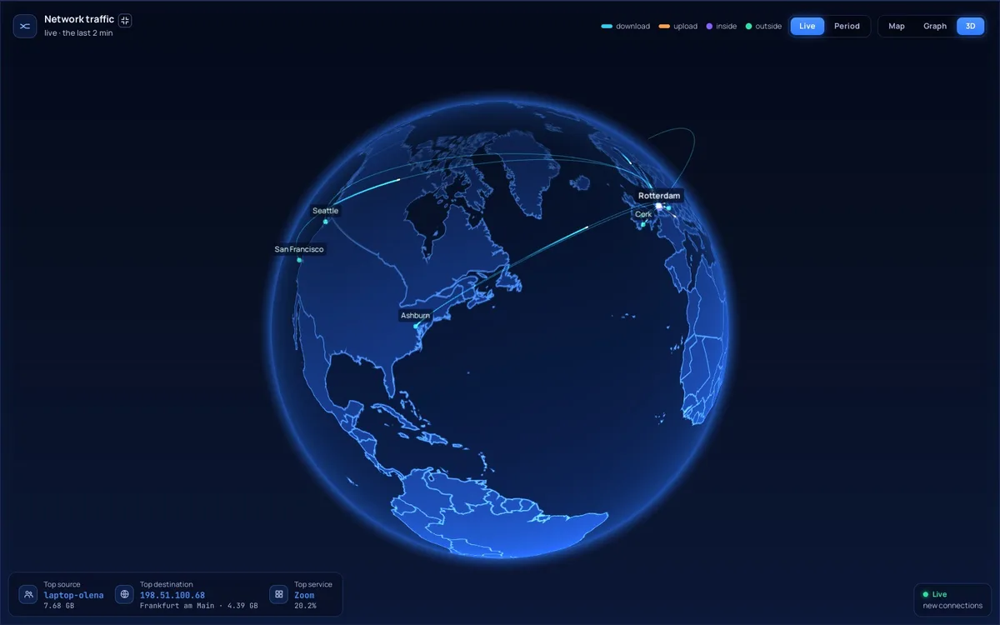</p>

### Flows — who exchanges how much with whom

The busiest inside hosts and outside addresses as a living diagram: width is volume, colour is direction. Click to
inspect, Shift+click to filter, down to the raw records with NAT, ASN and interfaces.

<p align="center">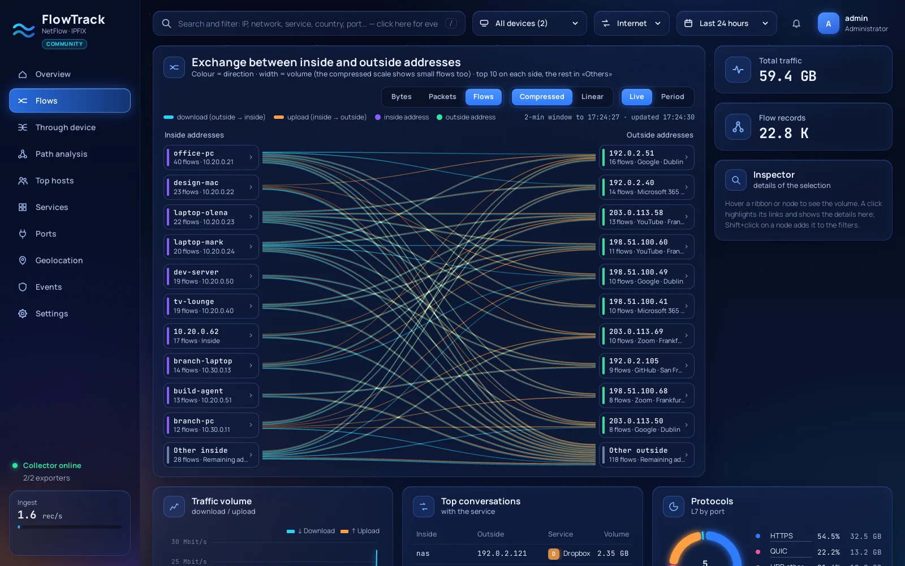</p>

### Conversations — who talks to whom

Every pair of an inside host and whom it talks to, over any period: our hosts → the services → who owns the addresses
outside (or the countries, or the addresses), as a flow, a chord or a matrix with exact bytes. Cards tell how many
pairs there are against the period before, the biggest one, the countries — and the **new conversations**: a host
talking to an owner it had not talked to in the 7 days before, the first sign of a new cloud service, an infected
machine or data leaving. Every pair with both directions, a search, «Only new» and CSV; a click filters every page.

<p align="center">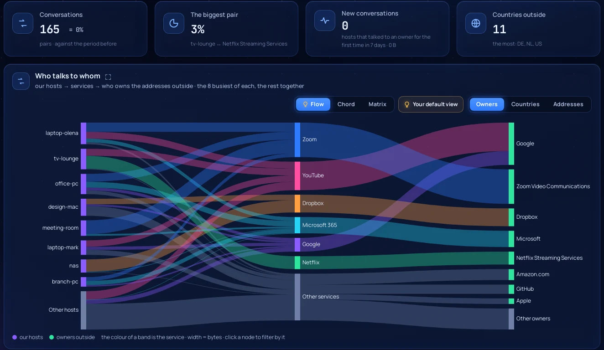</p>

<table>
<tr>
<td width="50%">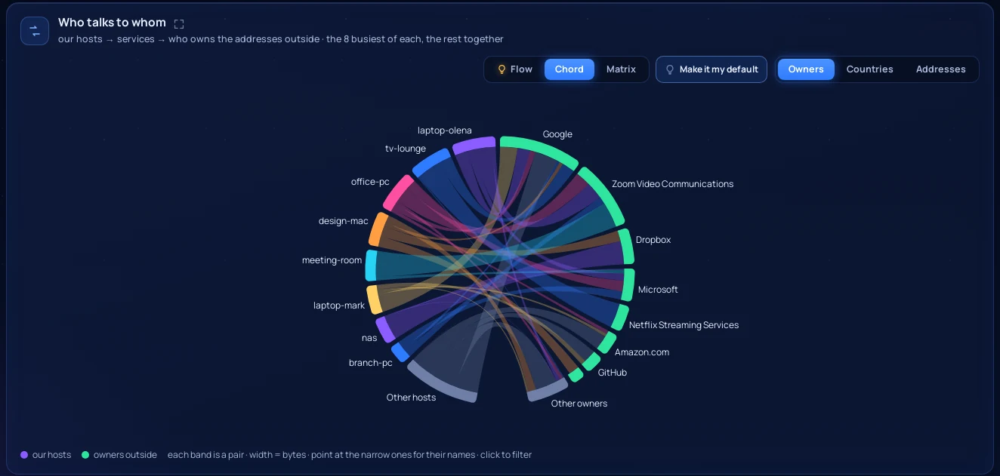</td>
<td width="50%">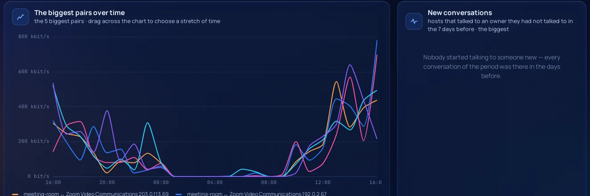</td>
</tr>
</table>

### Through device — inside one firewall

Input interface → device → output interface, the hosts behind each, and what each path carries.

<p align="center">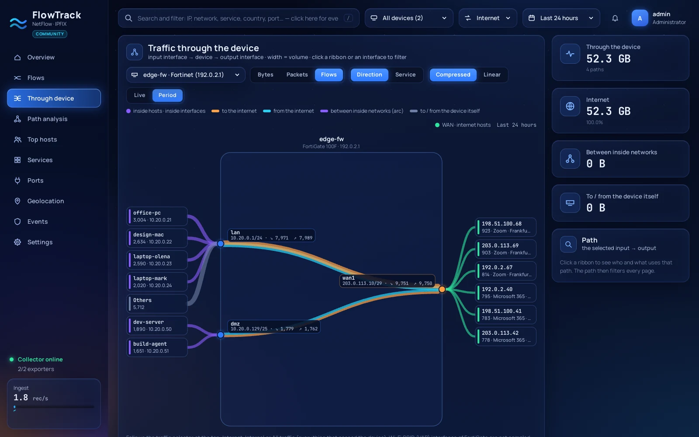</p>

**Interface load** — how full every link is: the peak, the 95th percentile and the average in and out against its
capacity (the port speed, or your own figures such as an ISP contract of 300 / 50), and an alert when a link stays
near its limit.

<p align="center">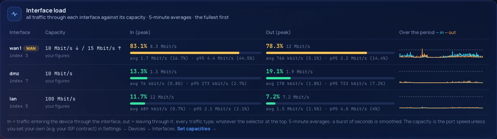</p>

### Capacity — know when a link fills up, weeks ahead

Every link of every device, day by day: how full it is in the busy hours, how fast that grows and **the date it
reaches 85 %** of its capacity — so the upgrade is ordered before users feel it, not after. The trend meets the
capacity on the chart, the heat map shows the hours of the week when the link is busy, and one sentence says it in
words. Quiet weekends do not pass for a decline, a noisy link is called unsteady instead of given a made-up date.

<p align="center">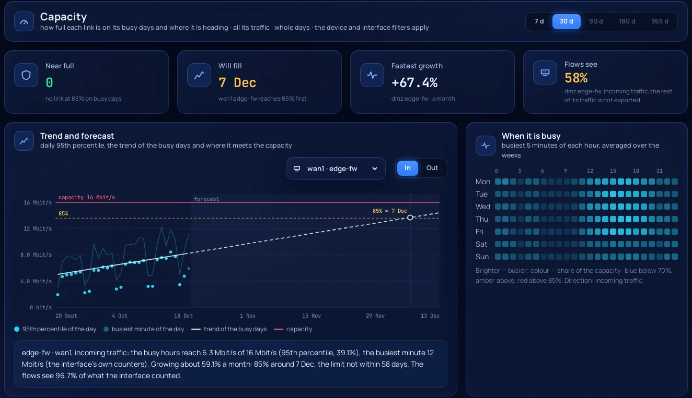</p>

**The interfaces' own counters.** With SNMP on, FlowSphera reads every interface's octet counters each minute: the
figures are every byte the port carried and the busiest minute, not only what the device exports — and it compares
the two. When the flows see only part of a link (an interface without a sampler, traffic exported twice), the page
says so at the top. Below: every link with its busy-hour load, trend, the date it fills and what the flows see; the
hosts and services that drive the growth; and the same in your scheduled reports as *Link capacity*.

<p align="center">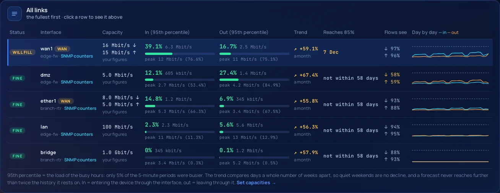</p>

### QoS — see how your traffic is prioritised

Every packet carries a class (DSCP) that tells the network what to put first — voice before downloads. FlowSphera shows
how much of your traffic is marked and how, which classes cross each interface, which services fall into each class
(is Zoom really voice and video, or best effort?), and what your devices re-mark on the way through. A class is a
filter like any other: `dscp:EF` narrows every page to it.

<p align="center">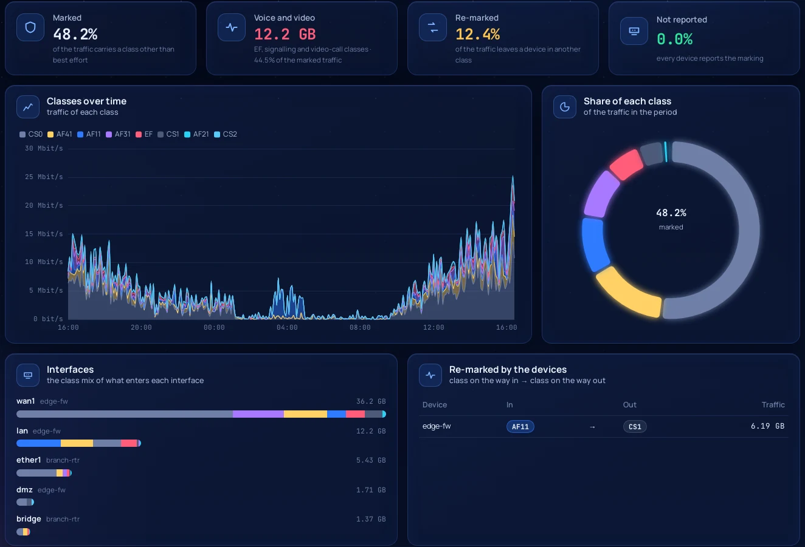</p>

### Top hosts and your own networks

Name your networks once (*172.16.0.0/24 → Office*) and see the traffic, trend and main services of each — or of every
single host.

<p align="center">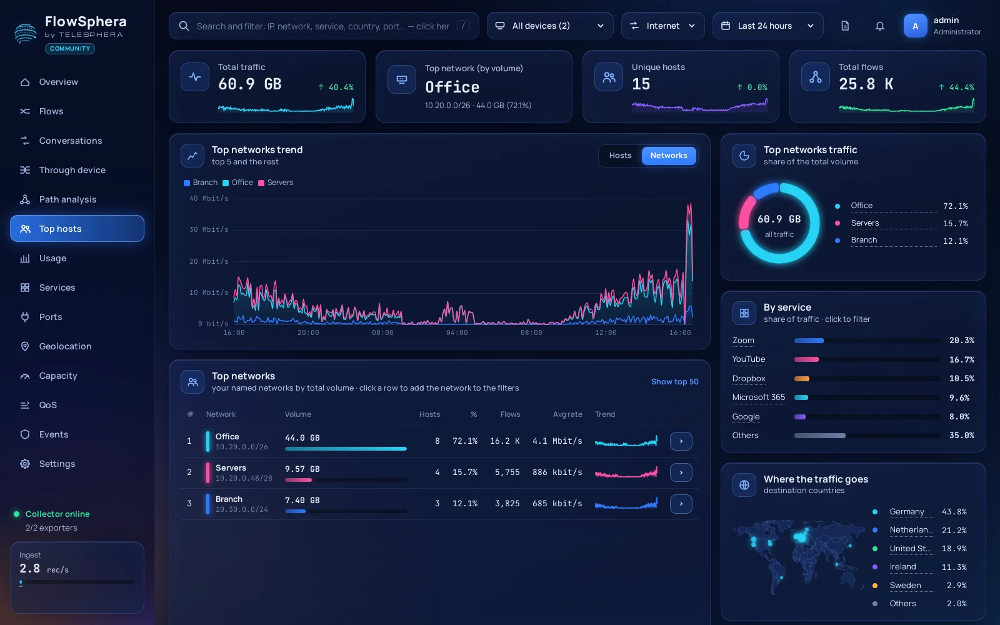</p>

### Usage — who used how much

What each host downloaded and uploaded over the period at the top — an hour, a day, a month or the dates you choose —
against the same time before it: totals and the change, the days, who uses most, who grew or dropped, each of your networks. Narrow it to a network,
a device or a service like any page; the full list of hosts downloads as a CSV for Excel or billing.

<p align="center">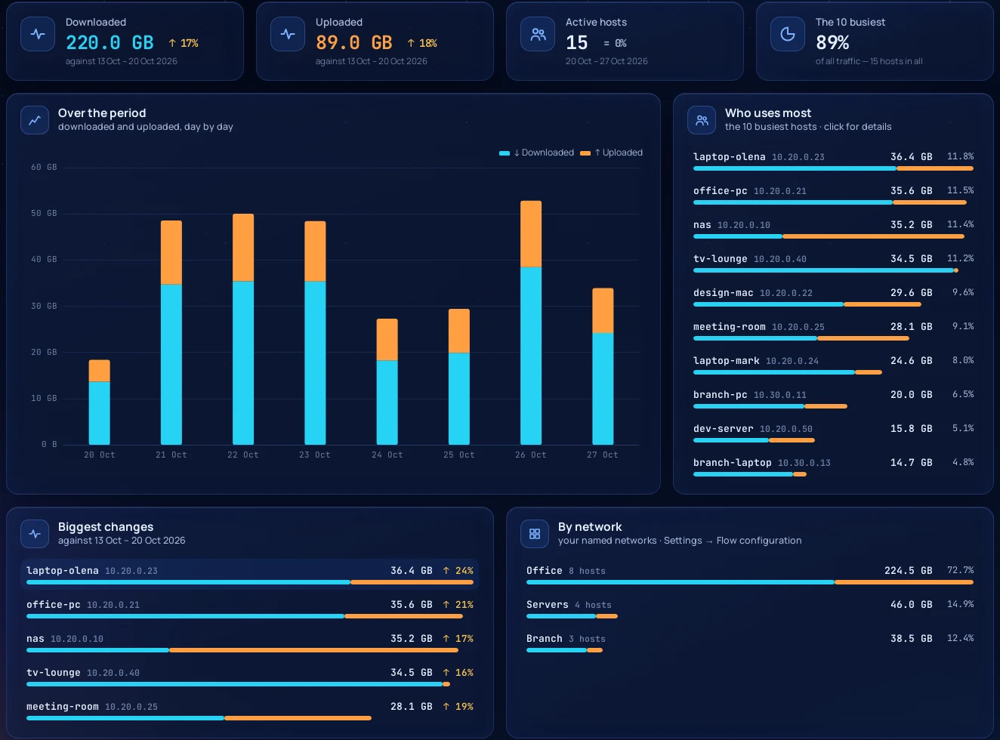</p>

### Services, countries, ASNs

<table>
<tr>
<td width="50%">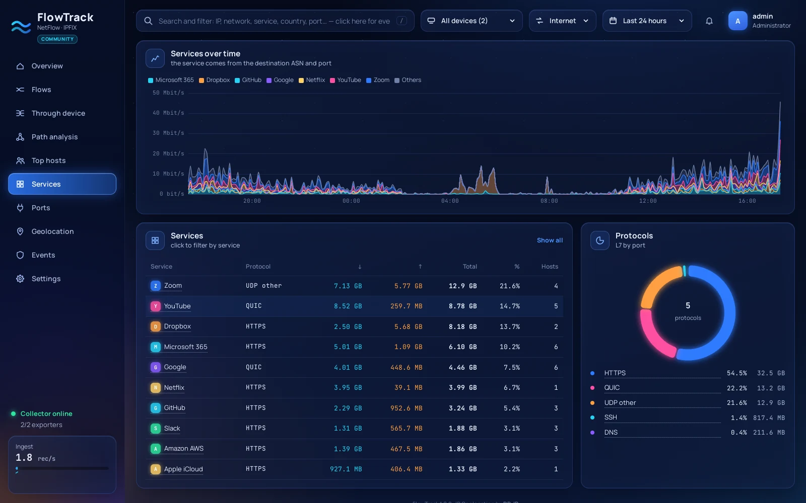</td>
<td width="50%">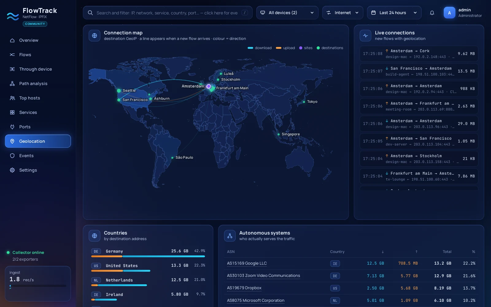</td>
</tr>
</table>

### Find anything by typing

`ip:10.0.0.5 service:Telegram -country:US port:443 net:Office` — the search box guides you through every filter, and
every value on every page is a click-to-filter. Any period, down to the minute; the link keeps it, so an incident view
can be shared.

<p align="center">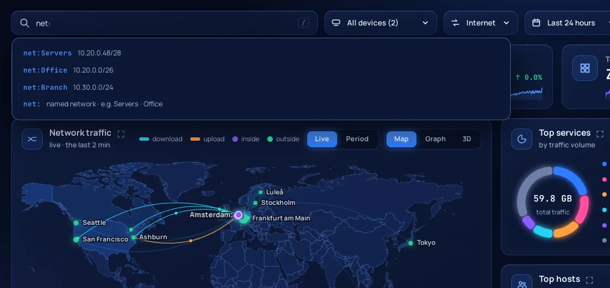</p>

### Security events

Port scans, password guessing on SSH / RDP / management ports, floods and DDoS against your usual peak, inside hosts
that scan, contact with addresses on eight public reputation lists (plus your own), sustained uploads, new countries
and exporter health. FlowSphera works out who opened each connection and which of your services are public, so busy
web sites stay quiet. New events go to Telegram (your own bot), e-mail, webhooks (Slack, Mattermost, Discord or your
own system) and your SIEM as syslog (CEF or JSON).

The page shows the picture first: how many events of each priority, how their number changes over the period by kind,
and the share of each kind. Pick a priority or a kind and the chart, the ring and the list follow it. Below — the newest
30 events with Filter / Exclude / Ignore; **All events** pages through the rest with a search by address or text.

<p align="center">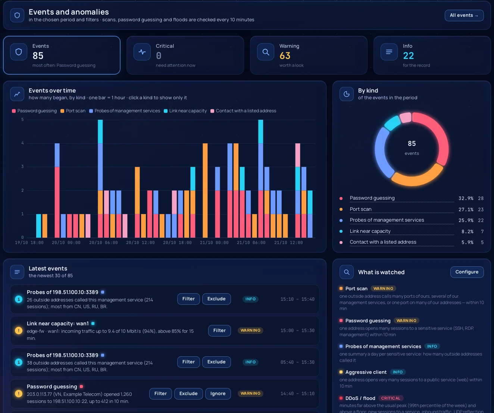</p>

The same two charts open the *Security events* part of every PDF report:

<p align="center">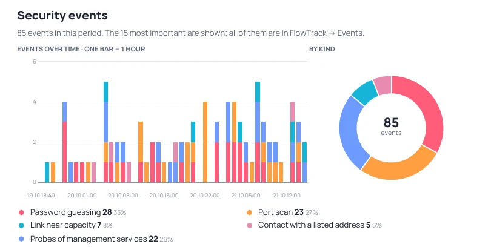</p>


### Reports — by e-mail, on schedule or for any period

A PDF for the management or the duty engineer: totals against the period before, traffic over time, the busiest hosts,
outside networks, the conversations and the new ones, services, countries, your networks, link capacity with the date each link fills, security events and the
devices. Daily, weekly or monthly on
the day and hour you choose, in English or Ukrainian — or, after an attack or an outage, for exactly the period and
filters on your screen, with one click.

<table>
<tr>
<td width="58%">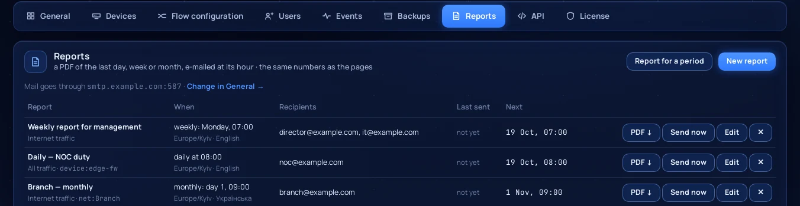</td>
<td width="42%">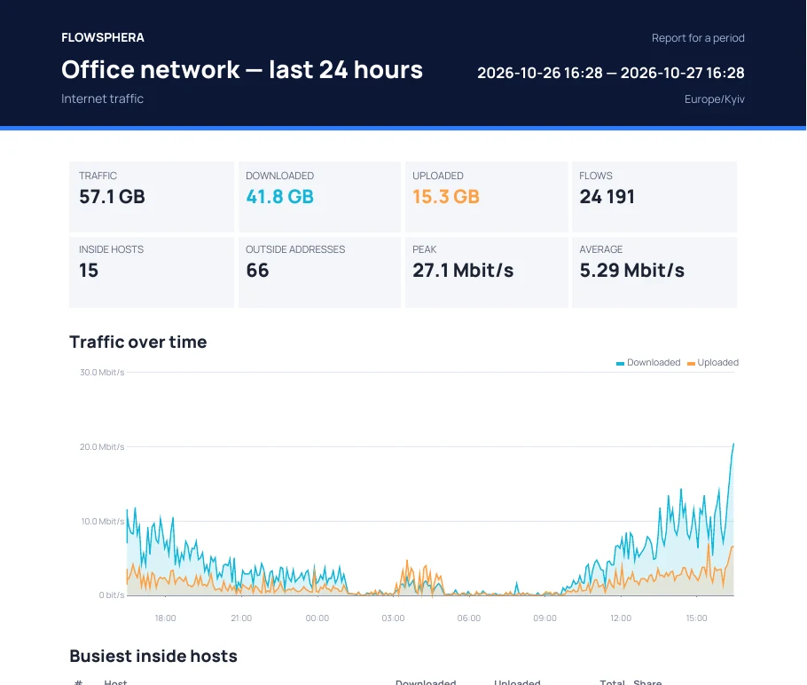</td>
</tr>
</table>

### Fits into your company

**Sign in with Active Directory or LDAP**: the sign-in page asks how to sign in — your directory or a local account —
and the role comes from the user's groups (nested ones too); LDAPS / STARTTLS, a check that shows what FlowSphera finds
for a user before you switch it on. **API tokens** let scripts and monitoring (Zabbix, Grafana, your own) read
FlowSphera — or change it, with a token that may — without a password; every host of a network with its upload and
download for any period comes as JSON or a CSV file for Excel or billing ([how](docs/api.md#export-every-host-of-a-network)). **Webhooks** send new events to Slack,
Mattermost, Rocket.Chat, Discord or your own system (signed with HMAC), and **syslog** in CEF or JSON feeds Splunk,
QRadar, ArcSight, Microsoft Sentinel, Elastic, Graylog or Wazuh.

<table>
<tr>
<td width="28%" valign="top">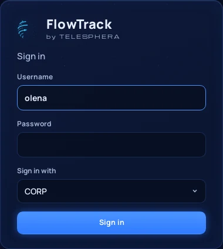</td>
<td width="72%" valign="top">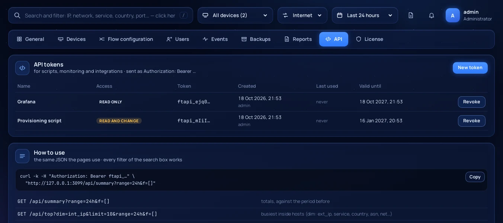</td>
</tr>
</table>

### Backups — your history is safe

Every night FlowSphera backs up the flow data and every setting on its own: a full backup once a week, only the changes
on the other days. Copies go to a folder on the server and, if you like, to S3-compatible storage, SFTP or FTP —
encrypted with your passphrase (AES-256-GCM). One click checks that a backup is whole; another restores it — on the
same server or on a brand-new one after a disk failure.

A power cut does not take the database down either: after an unclean stop FlowSphera opens it by itself, sums the
long-period totals again from the records and tells you in Events and on your notification channels what happened —
when the server stopped, what is missing, what was summed again.

<p align="center">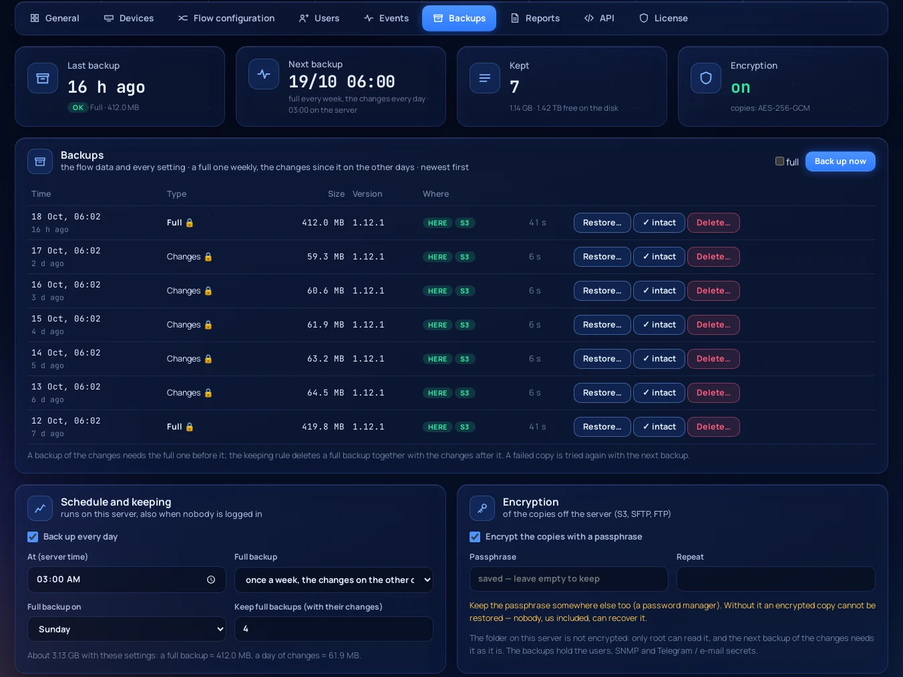</p>

### Fast on a busy network, over days

A day of a busy network is hundreds of millions of flow records. FlowSphera keeps summary tables — per 5 minutes and
per hour, filled as the records arrive — and every page over a day or more reads those instead of the records. The
numbers stay the same: before each release every summary table is checked row by row against the records.

<p align="center">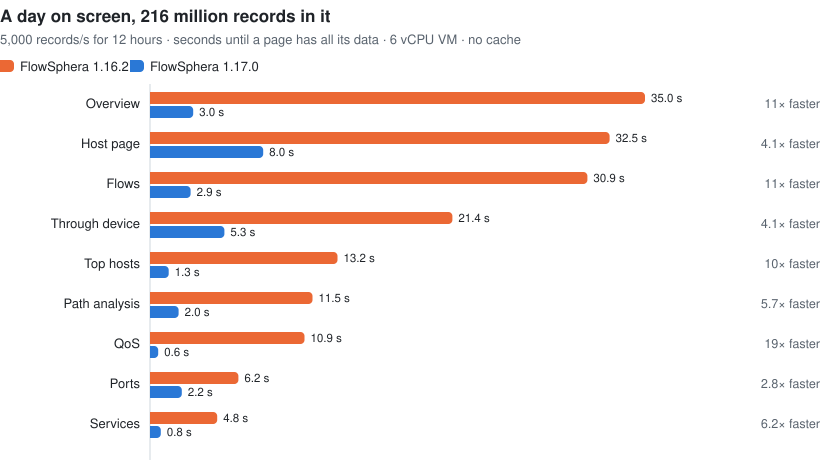</p>

Measured in FlowSphera's own test lab: a synthetic network sending 5,000 records/s (the most Community stores) for 12
hours — 216 million records — on 6 virtual cores of a laptop-class CPU, nothing cached. All the figures: [docs/performance.md](docs/performance.md).

## Works with your equipment

Ready configuration — with a **Copy** button — for each vendor and export protocol, right in *Settings → Devices*:

<p align="center">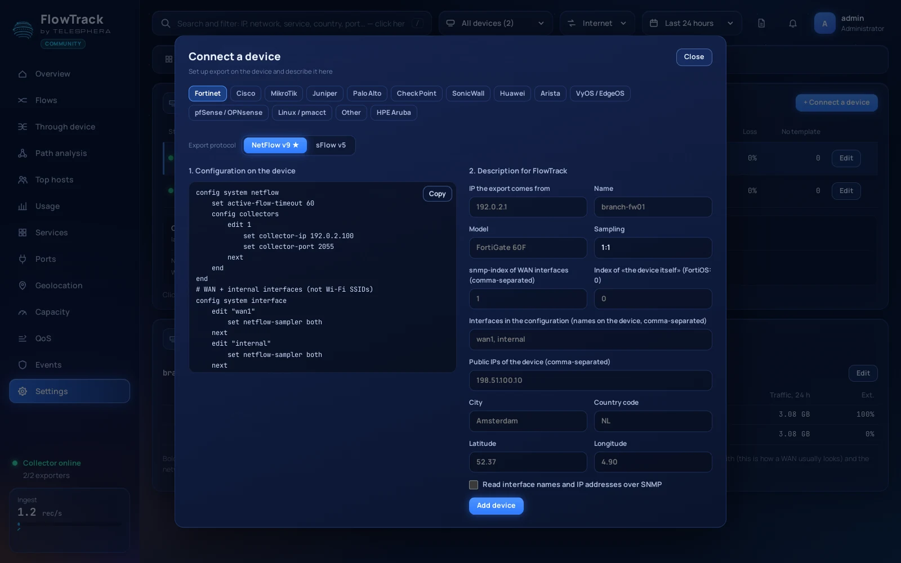</p>

**Fortinet** · **Cisco** · **MikroTik** · **Juniper** · **Palo Alto** · **Check Point** · **SonicWall** · **Huawei** ·
**Arista** · **HPE Aruba** · **VyOS / EdgeOS** · **pfSense / OPNsense** · **Linux** (pmacct, softflowd, hsflowd) · and
any other NetFlow v5 / v9, IPFIX or sFlow v5 exporter, over IPv4 or IPv6. Optional SNMP v2c / v3 names the interfaces.

## Install in one command

```bash
curl -fsSL https://raw.githubusercontent.com/telesphera/flowsphera/main/install.sh | sudo bash
```

The installer (English or Ukrainian) sets up everything, asks a few questions with sensible defaults and finishes with
the address of your FlowSphera and the configuration for your exporter. Later: `sudo flowsphera upgrade` — settings,
users and data stay.

- **Runs on** Debian / Ubuntu and Fedora / RHEL / Rocky / Alma, x86_64 or arm64.
- **Disk**: about 25 MB per million flow records; a small office needs a few hundred MB for 30 days.
- **Speed**: one decoding worker handles about 40,000 records/s, four about 100,000 — on a 4-core laptop-class CPU.
  A day on screen with 216 million records in it opens in 1–8 s ([performance](docs/performance.md)).

Unattended install, upgrades, all server commands: [docs/install.md](docs/install.md).

## Editions

| | **Community** — free | **Pro** — license for one server |
|---|---|---|
| Every feature, now and in future versions | ✓ | ✓ |
| Flow records per second | up to **5,000** | no limit (or per license) |
| Data kept (flows and every total built from them) | **30 days** | per license, e.g. 90 days |
| Activation | — | a license key, activated in a minute in Settings → License |

5,000 records/s covers homes, small and medium offices; a busy 1 Gbit/s internet edge typically exports a few thousand.
**For a Pro license, a demo or help with deployment: [flowsphera@telesphera.net](mailto:flowsphera@telesphera.net?subject=FlowSphera%20Pro).**
Details: [docs/editions.md](docs/editions.md).

## Documentation

| | |
|---|---|
| [Install and upgrade](docs/install.md) | one-line, unattended, upgrade, server commands, requirements |
| [Exporter configuration](docs/exporters.md) | FortiGate, Cisco, MikroTik, Juniper, Linux and more |
| [Features in detail](docs/features.md) | everything FlowSphera collects, computes and shows |
| [Backups and restore](docs/backups.md) | schedule, S3 / SFTP / FTP copies, encryption, restore on a new server |
| [Configuration](docs/configuration.md) | `/etc/flowsphera/env` |
| [Security](docs/security.md) | passwords, sessions, HTTPS, what runs where |
| [API](docs/api.md) | JSON endpoints, filters, API tokens, webhooks, SIEM / syslog |
| [Performance](docs/performance.md) | measured receiving and page speeds |
| [Editions and licensing](docs/editions.md) | limits, activating a license key, moving it to another server |
| [Translations](docs/translations.md) | adding a language: one file |
| [Repository layout and roadmap](docs/development.md) | for contributors |

## License

[Elastic License 2.0](LICENSE): free to use, run and modify, including in companies; not allowed: offering FlowSphera as
a hosted service or circumventing the license checks. The FlowSphera core (`ftcore`) ships compiled under the FlowSphera
End User License Agreement. Versions up to 1.1.0 were published under MIT and stay so. IP geolocation by
[DB-IP](https://db-ip.com), licensed under CC BY 4.0. Fonts Manrope and JetBrains Mono ship with FlowSphera under the
[SIL Open Font License 1.1](web/fonts/). PDF reports are made with [ReportLab](https://www.reportlab.com) (BSD).
Screenshots show demo data, no real network.
