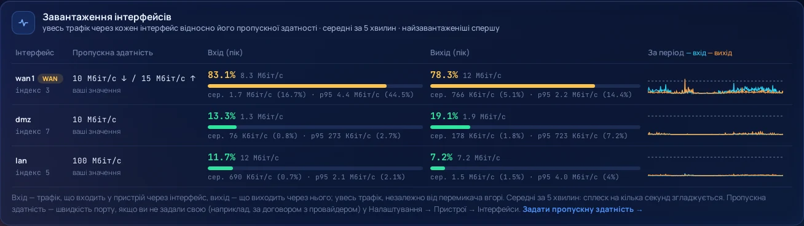
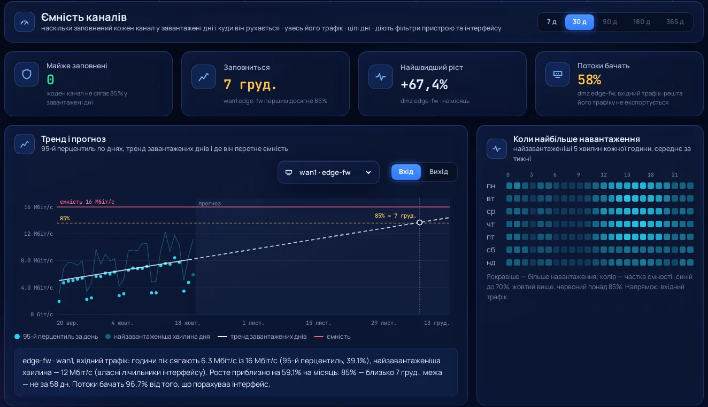
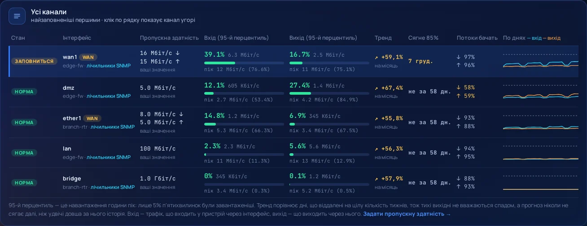
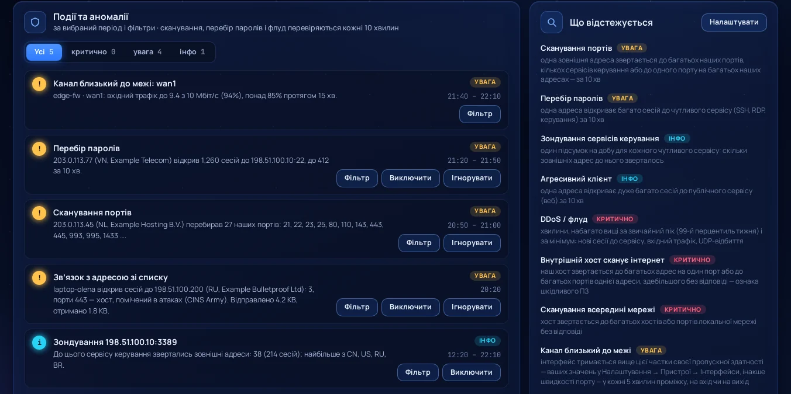
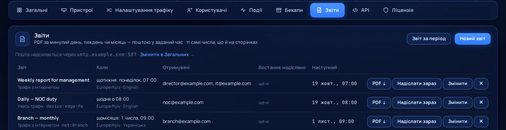
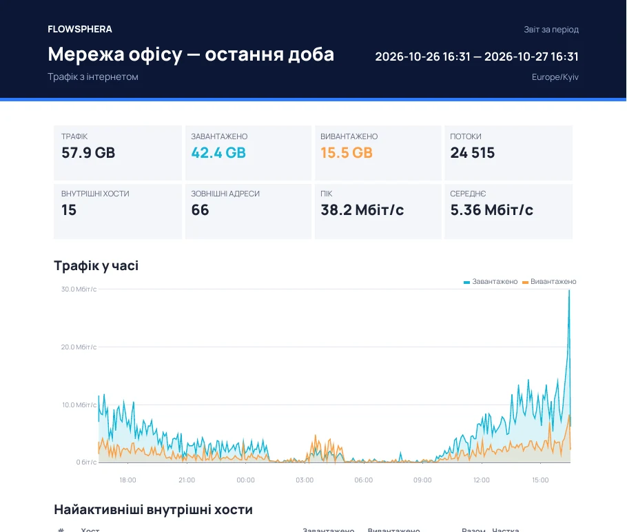
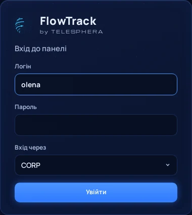
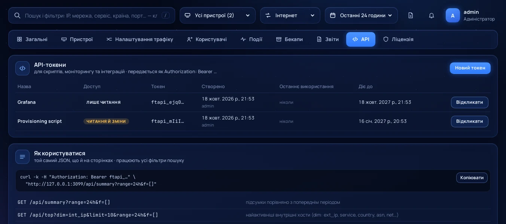
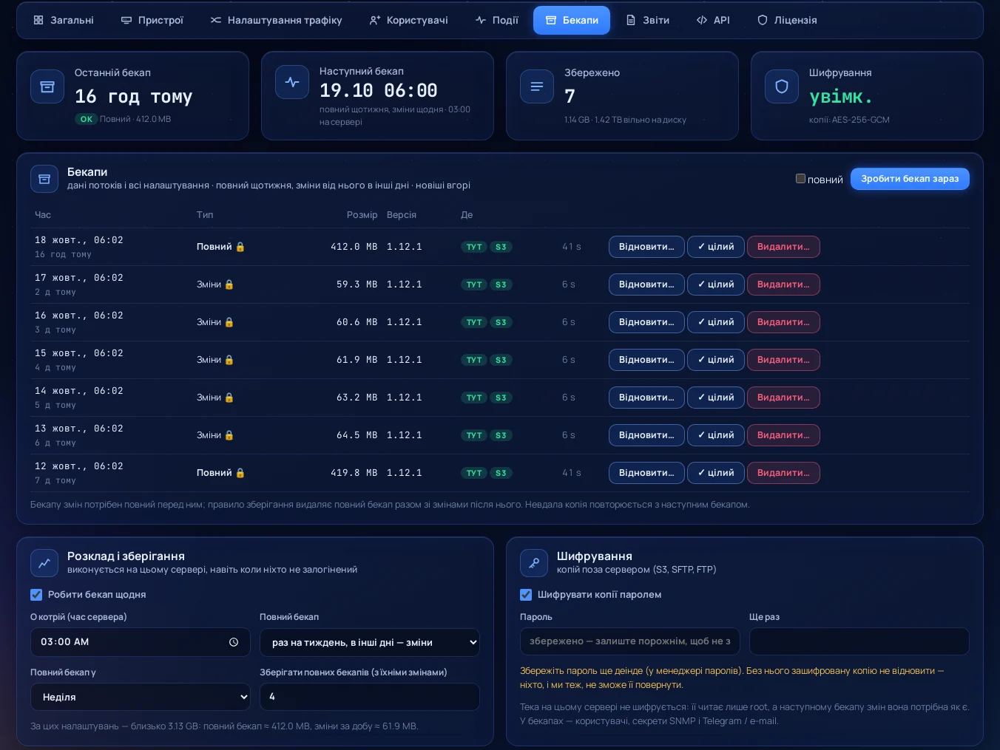

<p align="center">
  
</p>

<p align="center">
  <a href="https://github.com/henzelis/flowtrack/tags"></a>
  
  
  <a href="LICENSE"></a>
</p>

<p align="center">
  <a href="README.md">English</a> · <b>Українська</b>
  <br><br>
  <a href="#встановлення-однією-командою"><b>Встановлення</b></a> ·
  <a href="#огляд-можливостей">Огляд</a> ·
  <a href="#працює-з-вашим-обладнанням">Обладнання</a> ·
  <a href="#редакції">Редакції</a> ·
  <a href="#документація">Документація</a> ·
  <a href="mailto:henzelis@gmail.com?subject=FlowTrack">Контакт</a>
</p>

**FlowTrack** перетворює NetFlow, IPFIX і sFlow, які вже надсилають ваші міжмережеві екрани, маршрутизатори й
комутатори, на зрозумілу живу картину мережі: хто з ким обмінюється даними, скільки, через який сервіс, звідки і яким
шляхом. Він працює на вашому власному сервері, встановлюється однією командою і готовий за кілька хвилин.

<p align="center">
  
</p>

## Чому FlowTrack

<table>
<tr>
<td width="33%" valign="top"><b>Готовий за хвилини</b><br>Одна команда встановлює все — базу даних, вебінтерфейс, HTTPS — і видає готову конфігурацію для вашого міжмережевого екрана чи маршрутизатора.</td>
<td width="33%" valign="top"><b>Цифри, яким можна довіряти</b><br>Правильний облік довгих сесій, семплінгу й дубльованих експортів; кожен втрачений пакет порахований і показаний, а не зникає мовчки.</td>
<td width="33%" valign="top"><b>Видно шлях, а не лише потоки</b><br>Як трафік проходить вашими пристроями, інтерфейс за інтерфейсом, — і на якому зв'язку справжня проблема.</td>
</tr>
<tr>
<td valign="top"><b>Безпека вбудована</b><br>Сканування портів, підбір паролів, флуд, звернення до відомих шкідливих адрес, переповнені канали — зі сповіщеннями в Telegram, на e-mail, у вебхуки та вашу SIEM.</td>
<td valign="top"><b>Створений для стіни</b><br>Живі мапи, 3D-глобус і анімований трафік, які працюють на весь екран у NOC — плавно й легко для процесора.</td>
<td valign="top"><b>Ваш</b><br>На вашому сервері, без хмари й телеметрії. Усі функції безкоштовні; ліцензія лише знімає обмеження.</td>
</tr>
<tr>
<td valign="top"><b>Звіти, які приходять самі</b><br>PDF для керівництва чи чергового інженера — щодня, щотижня чи щомісяця поштою, або саме за інцидент, що на екрані.</td>
<td valign="top"><b>Вписується у вашу компанію</b><br>Вхід через Active Directory або LDAP; ролі з ваших груп; місцеві облікові записи лишаються запасним входом.</td>
<td valign="top"><b>Поєднується з вашими інструментами</b><br>API-токени для скриптів і моніторингу, вебхуки для чатів і ваших систем, syslog (CEF / JSON) для SIEM.</td>
</tr>
</table>

## Огляд можливостей

### Аналіз шляху — дивіться, як трафік рухається мережею

Кожен пристрій, що експортує потоки, його сусіди й трафік на кожному зв'язку так, як його записали обидва кінці, — у
русі, у справжньому напрямку. Розрив показується лише тоді, коли трафік іде, а назад нічого не повертається; усе інше
пояснюється простими словами. Будь-який шлях від джерела до призначення — хоп за хопом, з NAT.

<p align="center"></p>

Оберіть вигляд до смаку — кожен користувач зберігає свій типовий:

<table>
<tr>
<td width="33%" align="center"><br><b>Сузір'я</b></td>
<td width="33%" align="center"><br><b>Метро</b></td>
<td width="33%" align="center"><br><b>Ріка</b></td>
</tr>
</table>

### Огляд — уся мережа одним поглядом

Підсумки з трендами, жива мапа з'єднань або 3D-глобус, топ сервісів, хостів і розмов. Кожен блок розгортається на весь
екран.

<p align="center"></p>

<p align="center"></p>

### Потоки — хто з ким скільки обмінюється

Найактивніші внутрішні хости й зовнішні адреси як жива діаграма: ширина — обсяг, колір — напрямок. Клік — детально,
Shift+клік — фільтр, аж до окремих записів з NAT, ASN та інтерфейсами.

<p align="center"></p>

### Через пристрій — усередині одного міжмережевого екрана

Вхідний інтерфейс → пристрій → вихідний інтерфейс, хости за кожним і що несе кожен шлях.

<p align="center"></p>

**Завантаження інтерфейсів** — наскільки заповнений кожен канал: пік, 95-й перцентиль і середнє на вхід і вихід
відносно пропускної здатності (швидкість порту або ваші значення, наприклад договір з провайдером 300 / 50), і
сповіщення, коли канал тримається біля межі.

<p align="center"></p>

### Ємність каналів — знайте за тижні, коли канал заповниться

Кожен канал кожного пристрою, день за днем: наскільки він заповнений у години пік, як швидко це росте і **дата, коли
він сягне 85 %** ємності — щоб розширення замовили до того, як це відчують користувачі, а не після. На графіку видно,
де тренд перетне ємність, теплова карта показує години тижня, коли канал найзавантаженіший, а одне речення пояснює все
словами. Тихі вихідні не вважаються спадом, а нерівний канал позначається як нестійкий замість вигаданої дати.

<p align="center"></p>

**Власні лічильники інтерфейсів.** З увімкненим SNMP FlowTrack щохвилини читає лічильники байтів кожного інтерфейсу:
цифри — це кожен байт, що пройшов порт, і найзавантаженіша хвилина, а не лише те, що пристрій експортує, — і порівнює
одне з одним. Якщо потоки бачать лише частину каналу (інтерфейс без семплера, трафік, що експортується двічі), сторінка
каже про це вгорі. Нижче — усі канали з навантаженням у години пік, трендом, датою заповнення і тим, скільки бачать
потоки; хости й сервіси, що дають ріст; і те саме у ваших звітах за розкладом як розділ «Ємність каналів».

<p align="center"></p>

### Топ хостів і ваші мережі

Назвіть свої мережі один раз (*172.16.0.0/24 → Офіс*) і бачте трафік, тренд і головні сервіси кожної — або кожного
окремого хоста.

<p align="center"></p>

### Сервіси, країни, ASN

<table>
<tr>
<td width="50%"></td>
<td width="50%"></td>
</tr>
</table>

### Знайдіть що завгодно, просто набравши

`ip:10.0.0.5 service:Telegram -country:US port:443 net:Офіс` — поле пошуку підказує кожен фільтр, а кожне значення на
кожній сторінці фільтрує одним кліком. Будь-який період з точністю до хвилини; посилання його зберігає, тож картину
інциденту можна переслати колезі.

<p align="center"></p>

### Події безпеки

Сканування портів, підбір паролів до SSH / RDP / портів керування, флуд і DDoS відносно вашого звичайного піку,
внутрішні хости, що сканують, звернення до адрес із восьми публічних списків репутації (і вашого власного), тривале
вивантаження, нові країни та стан експортерів. FlowTrack визначає, хто відкрив кожне з'єднання і які ваші сервіси
публічні, тож навантажені сайти не засмічують події. Нові події надходять у Telegram (ваш власний бот), на e-mail,
у вебхуки (Slack, Mattermost, Discord чи ваша система) і у вашу SIEM як syslog (CEF або JSON).

<p align="center"></p>


### Звіти — поштою за розкладом або за будь-який період

PDF для керівництва чи чергового інженера: підсумки порівняно з попереднім періодом, трафік у часі, найактивніші хости,
зовнішні мережі, сервіси, країни, ваші мережі, ємність каналів із датою, коли кожен заповниться, події безпеки і стан
пристроїв. Щодня, щотижня чи щомісяця — у
вибраний день і годину, українською або англійською. А після атаки чи збою — саме за той період і з тими фільтрами,
що на екрані, одним кліком.

<table>
<tr>
<td width="58%"></td>
<td width="42%"></td>
</tr>
</table>

### Вписується у вашу компанію

**Вхід через Active Directory або LDAP**: сторінка входу питає, як увійти — через ваш каталог чи місцевим обліковим
записом, — а роль визначають групи користувача (зокрема вкладені); LDAPS / STARTTLS і перевірка, що показує, що
FlowTrack знаходить для користувача, ще до ввімкнення. **API-токени** дають скриптам і моніторингу (Zabbix, Grafana,
власному) читати FlowTrack — або змінювати, якщо токен це дозволяє — без пароля. **Вебхуки** надсилають нові події у
Slack, Mattermost, Rocket.Chat, Discord чи вашу систему (з підписом HMAC), а **syslog** у форматі CEF або JSON живить
Splunk, QRadar, ArcSight, Microsoft Sentinel, Elastic, Graylog чи Wazuh.

<table>
<tr>
<td width="28%" valign="top"></td>
<td width="72%" valign="top"></td>
</tr>
</table>

### Резервні копії — ваша історія в безпеці

Щоночі FlowTrack сам робить резервну копію даних потоків і всіх налаштувань: повну раз на тиждень, в інші дні — лише
зміни. Копії зберігаються в теці на сервері й за бажанням у сховищі, сумісному з S3, на SFTP чи FTP — зашифровані
вашим паролем (AES-256-GCM). Один клік перевіряє, що копія ціла, ще один — відновлює її: на цьому
ж сервері або на зовсім новому після відмови диска.

<p align="center"></p>

## Працює з вашим обладнанням

Готова конфігурація — з кнопкою **Копіювати** — для кожного вендора й протоколу експорту прямо в *Налаштування →
Пристрої*:

<p align="center"></p>

**Fortinet** · **Cisco** · **MikroTik** · **Juniper** · **Palo Alto** · **Check Point** · **SonicWall** · **Huawei** ·
**Arista** · **HPE Aruba** · **VyOS / EdgeOS** · **pfSense / OPNsense** · **Linux** (pmacct, softflowd, hsflowd) · а також
будь-який інший експортер NetFlow v5 / v9, IPFIX чи sFlow v5, через IPv4 або IPv6. За бажанням SNMP v2c / v3 підтягує
назви інтерфейсів.

## Встановлення однією командою

```bash
curl -fsSL https://raw.githubusercontent.com/henzelis/flowtrack/main/install.sh | sudo bash
```

Інсталятор (англійською або українською) налаштовує все, ставить кілька запитань із розумними відповідями за
замовчуванням і наприкінці показує адресу вашого FlowTrack та конфігурацію для експортера. Надалі:
`sudo flowtrack upgrade` — налаштування, користувачі й дані зберігаються.

- **Працює на** Debian / Ubuntu та Fedora / RHEL / Rocky / Alma, x86_64 або arm64.
- **Диск**: близько 25 МБ на мільйон записів потоків; невеликому офісу на 30 днів вистачить кількох сотень МБ.
- **Швидкість**: один робочий процес обробляє близько 40 000 записів/с, чотири — близько 100 000, на 4-ядерному
  процесорі ноутбучного класу.

Встановлення без запитань, оновлення, усі команди сервера: [docs/install.md](docs/install.md) (англійською).

## Редакції

| | **Community** — безкоштовно | **Pro** — ліцензія на один сервер |
|---|---|---|
| Усі функції, зараз і в майбутніх версіях | ✓ | ✓ |
| Записів потоків за секунду | до **5 000** | без обмеження (або за ліцензією) |
| Скільки зберігаються деталі потоків | **30 днів** (погодинні підсумки: 3 роки) | за ліцензією, напр. 90 днів |
| Активація | — | ліцензійний ключ, активація за хвилину в Налаштування → Ліцензія |

5 000 записів/с вистачає для дому, малого й середнього офісу; навантажений інтернет-канал 1 Гбіт/с зазвичай дає кілька
тисяч. **Ліцензія Pro, демонстрація чи допомога з впровадженням: [henzelis@gmail.com](mailto:henzelis@gmail.com?subject=FlowTrack%20Pro).**
Докладно: [docs/editions.md](docs/editions.md) (англійською).

## Документація

Технічна документація — англійською; інтерфейс програми й інсталятор — англійською та українською.

| | |
|---|---|
| [Встановлення й оновлення](docs/install.md) | однією командою, без запитань, оновлення, команди сервера, вимоги |
| [Налаштування експортерів](docs/exporters.md) | FortiGate, Cisco, MikroTik, Juniper, Linux та інші |
| [Можливості докладно](docs/features.md) | усе, що FlowTrack збирає, обчислює й показує |
| [Резервні копії](docs/backups.md) | розклад, копії на S3 / SFTP / FTP, шифрування, відновлення на новому сервері |
| [Конфігурація](docs/configuration.md) | `/etc/flowtrack/env` |
| [Безпека](docs/security.md) | паролі, сесії, HTTPS, що де працює |
| [API](docs/api.md) | JSON-ендпоінти, фільтри, API-токени, вебхуки, SIEM / syslog |
| [Продуктивність](docs/performance.md) | виміряні швидкості прийому й сторінок |
| [Редакції та ліцензування](docs/editions.md) | ліміти, активація ліцензійного ключа, перенесення на інший сервер |
| [Переклади](docs/translations.md) | нова мова — один файл |
| [Структура репозиторію й плани](docs/development.md) | для розробників |

## Ліцензія

[Elastic License 2.0](LICENSE): можна вільно використовувати, запускати й змінювати, зокрема в компаніях; не можна —
надавати FlowTrack як хостинговий сервіс чи обходити перевірку ліцензії. Ядро FlowTrack (`ftcore`) постачається
скомпільованим за Ліцензійною угодою кінцевого користувача FlowTrack. Версії до 1.1.0 опубліковано за MIT, і вони
такими лишаються. IP-геолокація — [DB-IP](https://db-ip.com), ліцензія CC BY 4.0. Шрифти Manrope і JetBrains Mono
постачаються з FlowTrack за [SIL Open Font License 1.1](web/fonts/). PDF-звіти створює
[ReportLab](https://www.reportlab.com) (BSD). На скриншотах — демонстраційні дані,
не реальна мережа.
